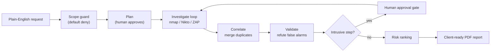
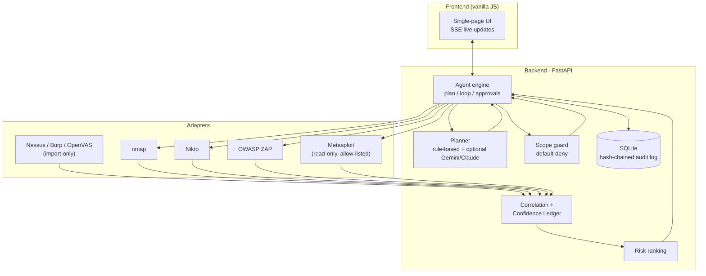
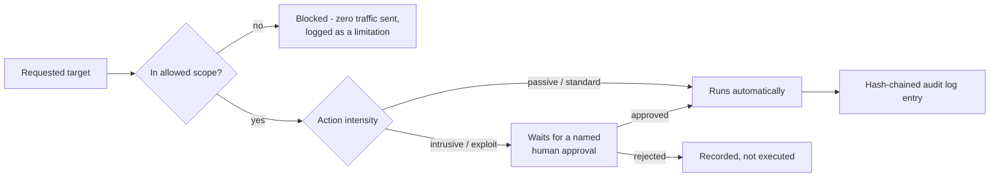

# ARGUS - AI-Powered Unified VAPT Agent

[](LICENSE)
[](backend/tests)
[](requirements.txt)
[](lab/docker-compose.yml)

**DataOps Innovation Hackathon 2026, Problem Statement 1.** Team **Binary Builders** - Pawan Singh Bhandari & Rahul Bramhankar.

ARGUS is a conversational agent that runs an **authorized** vulnerability assessment and penetration test from reconnaissance to a client-ready PDF report. It plans each step from what it has already found, runs real tools, merges duplicate findings, removes false positives with a safe re-check, ranks risk with a formula you can read, and asks a human before any intrusive action.

## How it works



| Stage | What happens |
|---|---|
| Scope | A deterministic guard (plain code, not AI) checks every target, tool and intensity. Default deny. Out-of-scope targets get no traffic. |
| Plan | The agent shows its plan and waits for approval. |
| Investigate | A hypothesis-driven loop picks the next action, runs it, and writes a Decision Card (what it saw, options considered, why it chose one). |
| Correlate | Findings from different tools are merged into one, keeping all evidence. A Confidence Ledger gives a 0-100 score with written reasons. |
| Validate | Safe one-request checks confirm or refute web-config claims (for example HSTS on a plain-HTTP site is refuted). |
| Approve | Intrusive actions (active ZAP scan, Metasploit read-only modules) wait for a named human approval. A kill switch stops everything. |
| Report | PDF with executive summary, methodology, ranked findings, evidence index, remediation, limitations, decision log and audit trail. |

## Architecture at a glance



## Quick start (Windows, Docker Desktop required)

```powershell
git clone https://github.com/RAHUL0408-B/DataOps.git
cd DataOps
pip install -r requirements.txt
.\scripts\start.ps1          # builds + starts the lab containers, then serves the UI
```

Open <http://localhost:8765>. Stop the lab with `.\scripts\stop.ps1` (removes only the ARGUS containers).

First run pulls images (DVWA, Juice Shop, ZAP, a Debian tools image) and builds the tools image; allow several minutes. The Metasploit image is pulled only the first time an approved Metasploit check runs.

### Requirements

- Windows 10/11 (also works on Linux/macOS; scripts are PowerShell, the commands inside are plain `docker compose` and `uvicorn`)
- Docker Desktop with about 6 GB free RAM
- Python 3.11 or newer (developed on 3.14)
- No API key needed. See "AI planner" below.

### The lab

`lab/docker-compose.yml` creates an isolated network `argus-lab_labnet` (10.77.0.0/24):

| Address | Container | Role |
|---|---|---|
| 10.77.0.10 | argus-dvwa | deliberately vulnerable web app (test target) |
| 10.77.0.11 | argus-juice | OWASP Juice Shop (test target) |
| 10.77.0.2 | argus-tools | nmap, nikto, curl run here (excluded from scope) |
| 10.77.0.3 | argus-zap | OWASP ZAP daemon (excluded from scope) |
| 10.77.0.1 | Docker gateway = your own PC | **excluded from scope** |

The default scope in `backend/argus/api.py` (`lab_scope`) allows only the lab network and excludes .1, .2 and .3. To test an organizer-provided lab, change `targets` and `exclusions` there (or send a `scope` object with `POST /api/assessments`).

`scripts\start.ps1` runs `scripts\lab_init.ps1` automatically after `docker compose up`: it creates the DVWA database (a fresh container has none), logs in as `admin`/`password`, confirms DVWA's security level is `low`, and registers that session with ZAP's **httpSessions API** so ZAP's own spider/active scan (which never fills in a login form by itself) rides an authenticated session and actually reaches `/vulnerabilities/*` instead of bouncing off `login.php`. It then re-spiders and verifies the authenticated pages are actually reachable before finishing, retrying the whole sequence up to 3 times if needed. Safe to re-run any time the lab containers are rebuilt.

## Using the UI

1. Pick a preset or type a request, then **Check scope & make a plan**.
2. Read the plan and press **Approve plan**. Watch **Live activity**.
3. Open **Overview** and **Findings**. Click a finding to see observed evidence, confidence reasons, the priority formula, and the fix.
4. Decide pending **Approvals** (risky steps). Use **Ask ARGUS** for grounded questions.
5. Download the **Report**. After fixing something, press **Retest** on the finding.

A dark and light theme are both available (toggle in the top-right of the header); dark is the default.

Deep link: `http://localhost:8765/?a=<assessment id>&tab=findings`.

## AI planner

- Default: a deterministic **rule planner** picks among candidate actions that code generated from the current state, and writes a plain-text reason for every option it considered. No API key is required, and this alone satisfies "explain the rationale behind its next steps" with zero external dependency.
- Optional LLM ranking layer: set `GEMINI_API_KEY` (Google AI Studio, free tier) or `ANTHROPIC_API_KEY` (Claude) and the model ranks the same code-generated candidates and writes the rationale -- it can only pick an action the rule planner already generated, never invent one. If both keys are set, Gemini is tried first. Its answer is validated against the candidate list and against the grounding check (no uncited CVE/CVSS) and falls back to the rule planner on any problem.
- Honest status: both paths are unit-tested with a mocked API response (prompt-injection guard: a model trying to return a non-candidate action id is rejected). **The Gemini path has been run live** against the real Gemini API (`gemini-flash-lite-latest`) end-to-end through the actual engine loop, producing genuine contextual rationale (e.g. correctly reasoning about a discovered "Apache httpd 2.4.25 web service" instead of generic text). The Claude path remains unit-tested only (no Anthropic key was available).
- The model never executes anything and never sees raw credentials or tokens (`planner.redact` strips them from the prompt first). Confidential data is not sent anywhere in rules-only mode.

## Integration status (truthful)

See [docs/INTEGRATIONS.md](docs/INTEGRATIONS.md). Summary: nmap, Nikto, OWASP ZAP and approved read-only Metasploit modules are **Live**. Nessus, Burp and OpenVAS are **Import-only**. The UI **Tools** tab probes this at runtime.

## Tests

```powershell
cd backend
python -m pytest -q      # 34 tests: scope guard, audit chain, parsers, correlation, risk, grounding, report, robustness, out-of-scope filtering, criticality, redaction, retest history, LLM candidate-injection guard (Claude + Gemini)
cd ..
python scripts\e2e_live.py           # live end-to-end suite against the lab (server + lab must be running)
python scripts\make_test_report.py    # builds docs/ARGUS_Test_Report.pdf from the results
```

## Documentation

- [docs/PROJECT_OVERVIEW.md](docs/PROJECT_OVERVIEW.md) - full project overview
- [docs/ARCHITECTURE.md](docs/ARCHITECTURE.md) - components and data flow
- [docs/INTEGRATIONS.md](docs/INTEGRATIONS.md) - tool status matrix and limits
- [docs/AI_DISCLOSURE.md](docs/AI_DISCLOSURE.md) - AI-generated code and data handling
- [docs/ARGUS_Sample_VAPT_Report.pdf](docs/ARGUS_Sample_VAPT_Report.pdf) - report from a real run against the lab

## Licensing assumptions

- ARGUS source: [MIT License](LICENSE). It covers only the ARGUS code in this repository, not the tools it drives.
- Use ARGUS only against systems you are authorized to test. The licence grants no permission to test anyone else's systems.
- Third-party tools run as separate processes or containers and are not bundled: nmap (NPSL), Nikto (GPL-2.0), OWASP ZAP (Apache-2.0), Metasploit Framework (BSD-3, image pulled on demand), DVWA (GPL), OWASP Juice Shop (MIT).
- Python libraries: FastAPI (MIT), pydantic (MIT), uvicorn (BSD), httpx (BSD), reportlab (BSD open-source edition), anthropic SDK (MIT, optional).
- Nessus and Burp are commercial; ARGUS only reads exported files you provide. The files in `samples/` are **synthetic test inputs written by us**, not real scanner output, and contain no CVEs.

## Safety rules the code enforces



- Test only authorized targets. Default deny; CIDR targets must be fully inside the authorized network; exclusions always win.
- Intrusive and exploit-class actions need a recorded human approval. There are no exploit modules and no payload handling.
- Nothing is fabricated: every finding cites saved evidence with a SHA-256 hash, and a grounding check rejects unknown evidence ids, unseen CVEs and CVSS values no tool reported.
- Hash-chained audit log of every action, verifiable at `/api/health` and in the Report tab.
- Kill switch cancels running jobs.
